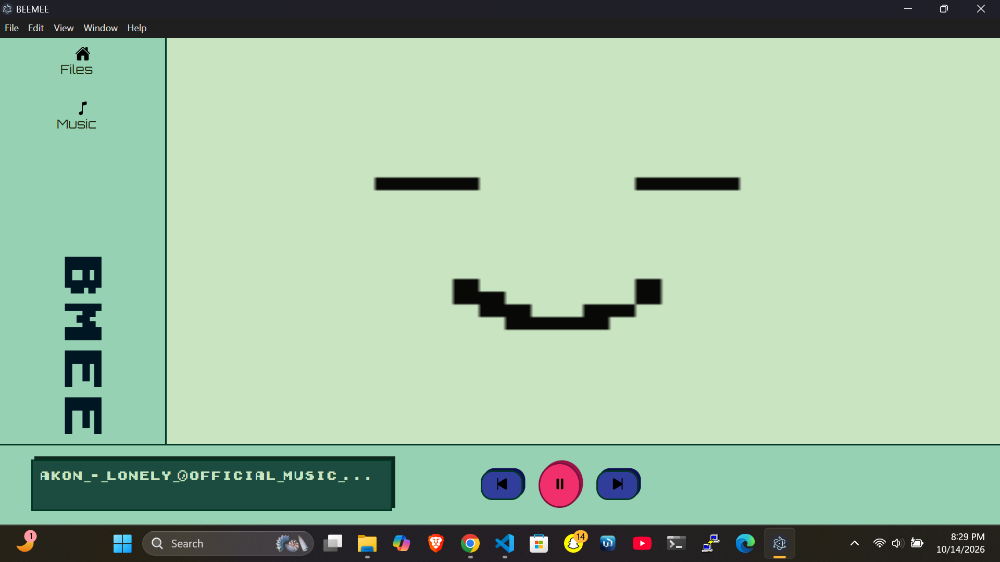
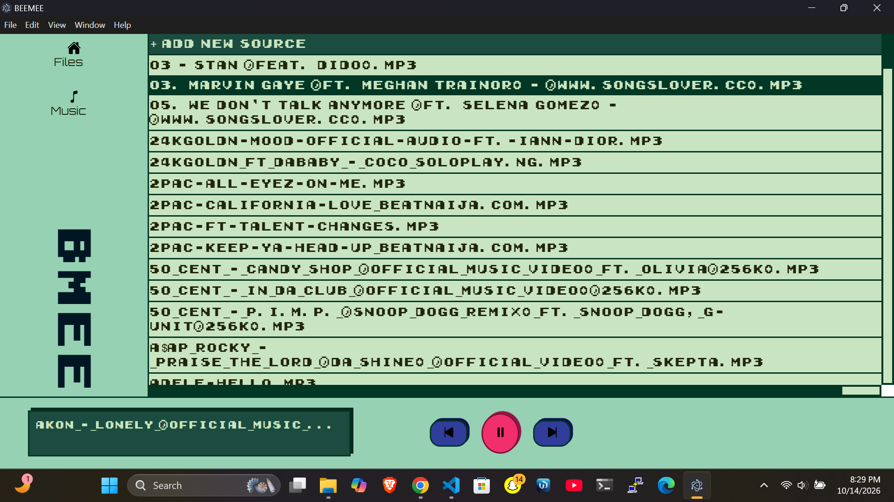
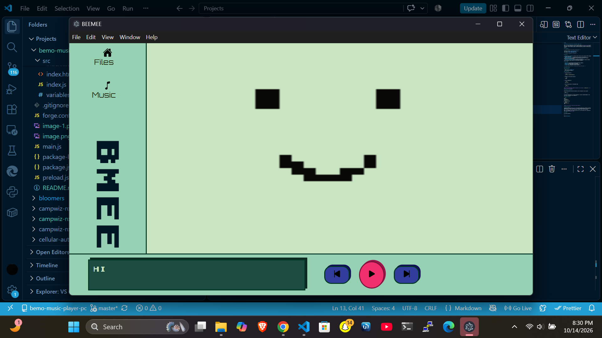

# BME

**Your music. Your world. Your little music buddy. 🎵**

BME is an offline desktop music player inspired by BMO from *Adventure Time*. Designed to bring a little personality to your listening experience, it lets you enjoy your local music library through a playful interface inspired by everyone's favorite gaming console.

## Screenshots

The music files shown in the screenshots are used for demonstration purposes only. BME does not distribute music files.







## Features

- **Offline Music Playback** — Listen to music stored locally on your device without an internet connection.
- **Desktop Experience** — A dedicated music player built with Electron.
- **BMO-Inspired Design** — A playful interface inspired by BMO's distinctive look and personality.
- **Local Music Library** — Enjoy music files stored on your device.
- **Personal Listening Experience** — A desktop music player designed to feel like your own little music companion.

## Tech Stack

- **Electron** — Desktop application framework.
- **JavaScript** — Application logic and interactivity.
- **HTML & CSS** — Interface structure and styling.

## Getting Started

### Prerequisites

- [Node.js](https://nodejs.org/)
- npm (included with Node.js)

### Installation

1. Clone the repository:

   ```bash
   git clone https://github.com/DannyK05/bme-music-player-pc.git
   ```

2. Navigate to the project directory:

   ```bash
   cd bme
   ```

3. Install dependencies:

   ```bash
   npm install
   ```

4. Start the application using the development script defined in `package.json`.

   ```bash
   npm start
   ```


## Building for Production

Build the application using the script configured in `package.json`:

```bash
npm run make
```

The commands for packaging the app into a desktop executable or installer depend on the Electron build tools configured in the project.

## Project Structure

```text
bme/
├── src/
│   ├── assets/
│   ├── data/
│   ├── widget/
│   ├── index.css
│   ├── index.html
│   ├── index.js
│   └── variable.css
├── assets/
│   └── readme/
│       ├── image.png
│       ├── image-1.png
│       └── image-2.png
├── package.json
├── package-lock.json
└── preload.js
```

*This structure is based on the files currently documented and may need adjustment to match the repository.*

## Design Inspiration

Inspired by BMO from *Adventure Time*, BME explores how a familiar fictional character can influence the design of a practical desktop application.

The goal is simple: make listening to local music feel playful, personal, and a little nostalgic.

BME is an independent fan-inspired project and is not affiliated with or endorsed by the creators of *Adventure Time*.

## Roadmap

- [ ] Add a customizable widget.
- [ ] Explore integration with Spotify Liked Songs.
- [ ] Migrate the interface to React.

## License

No license specified.

---

Built by **Kxlade** with 🎵 and a little bit of BMO magic.